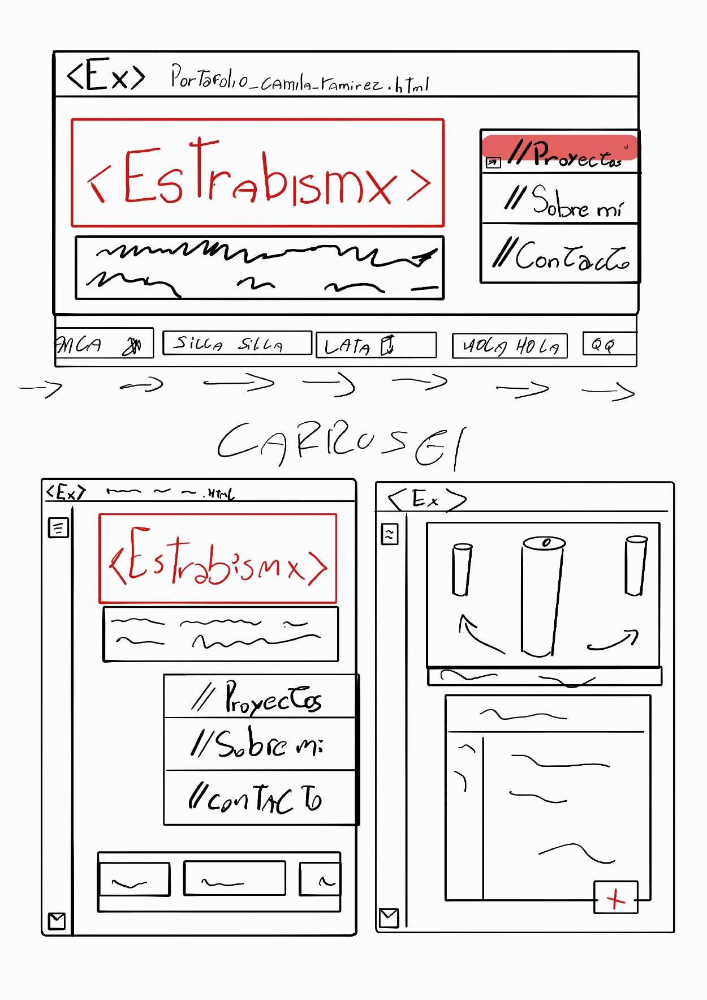
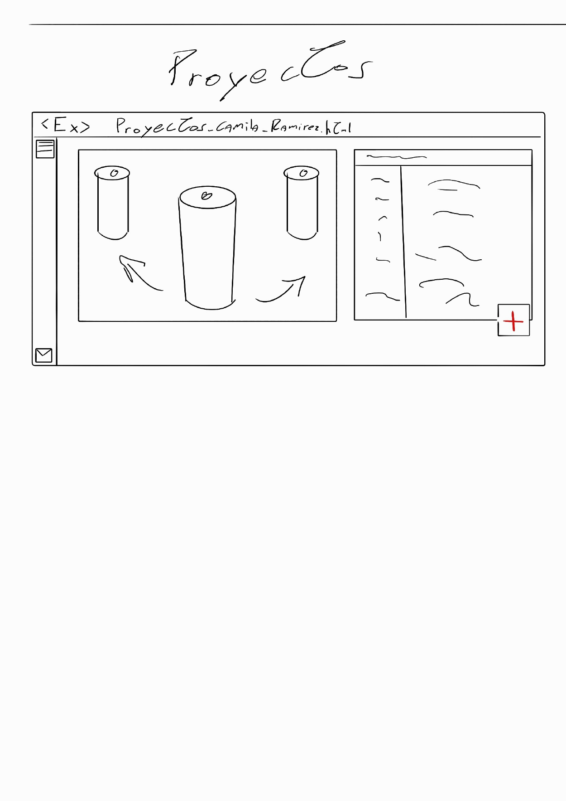
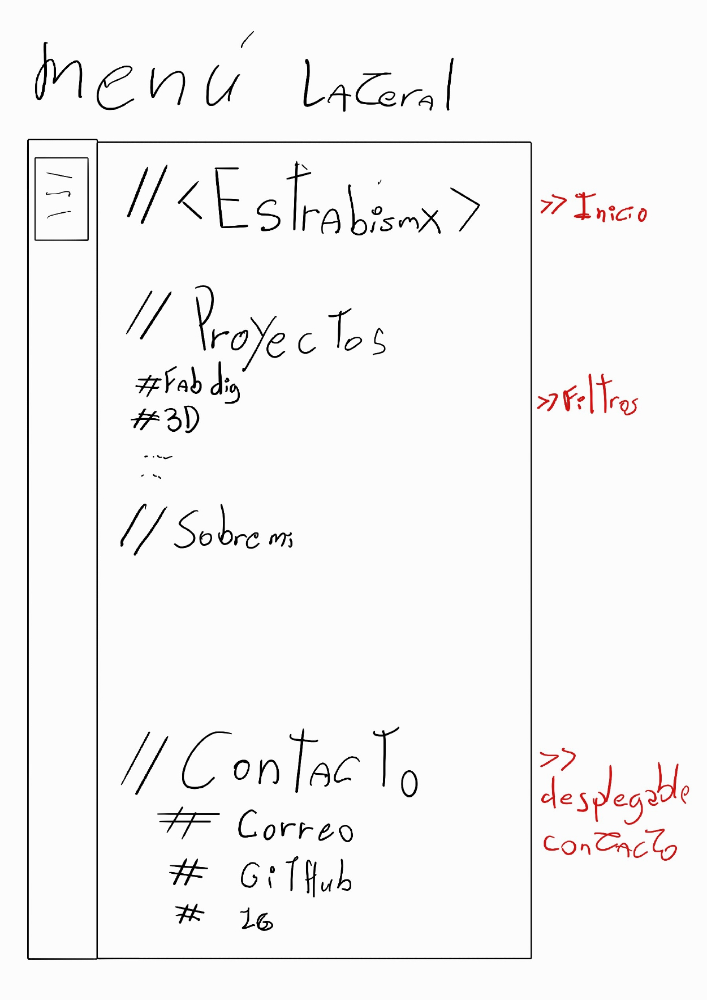
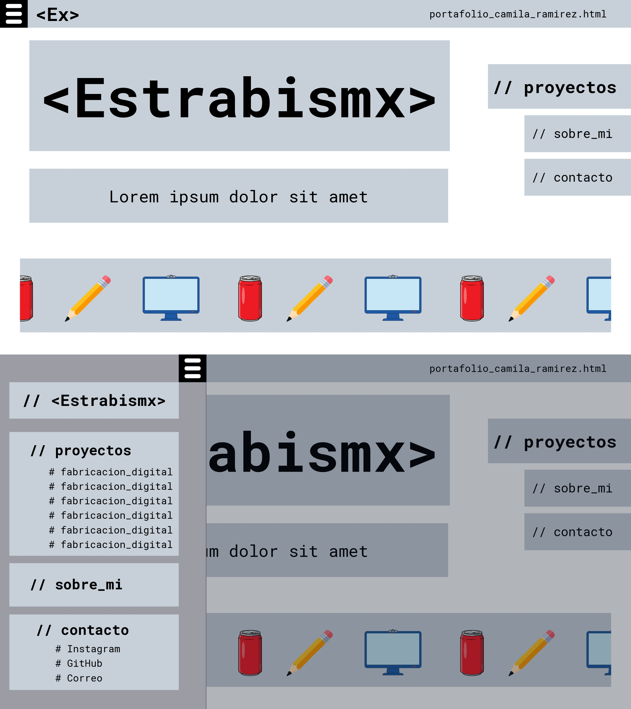
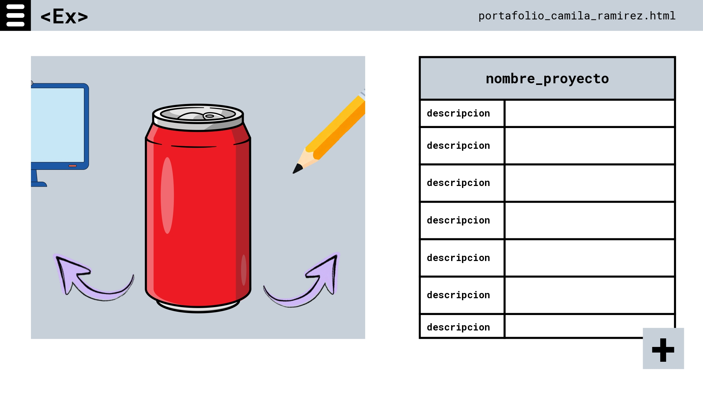
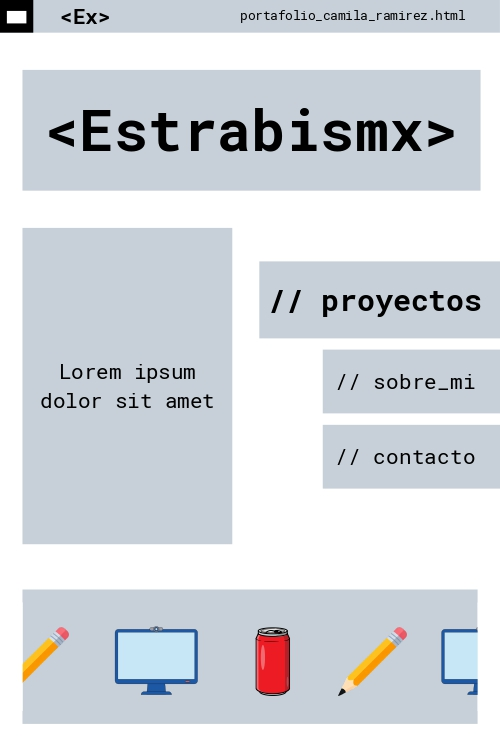
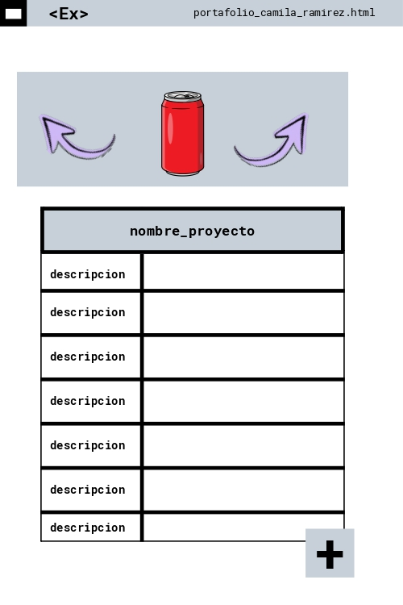

# Portafolio

Diseñador(x) de Santiago de Chile, trabajando bajo el seudónimo [***"Estrabismx"***](https://estrabismx.github.io/portafolio/
).

 

## Antecedentes

### Glosario

Conjunto de conceptos que se trabajaron en el semestre

- GitHub: Repositorio alojado en la nube en el cual se sube documentación y código de distintos proyectos

- Visual Studio Code: Entorno de desarrollo optimizado para la programación

- Lenguaje de programación: Conjunto de reglas y sintaxis que definen una manera de desarrollar software

- Markdown: Lenguaje de programación usado para redactar docuementación en GitHub

- HTML: Lenguaje de programción usado como base para el desarrollo web

- CSS: Lenguaje de programción usado como base para el desarrollo web, aplica el estilo gráfico

- JavaScript: Lenguaje de programción utilizado en distintos contextos como webs, servidores por su dinamismo

- Python: Lenguaje de programción sencillo de leer y comprender, está pensado en el programador más que en el programa o computadora

- GitHub Pages: Es un servidor de pagínas web alojado en GitHub

### 1er Intento

Anteriormente intente hacer un portafolio en GitHub Pages pero al no tener conocimientos base fue bastante complejo, ya que no entendía los distintos lenguajes de programación y el flujo de trabajo al no tener conocimientos previos fue caotico.

## Proceso

Para desarrollar esta versión fue significativamente más sencillo, gracias al conocimiento adquirido. Por lo tanto, para evitar la complejidad de cargar proyectos a futuro y poder establecer un flujo de trabajo optimo decidí armar una herramienta en python que se encargara de renombrar archivos, organizarlos y adaptarlos a `index.html`, `style.css` y `main.js`

Esta herramienta me fue muy útil y planeo eventualmente profundizar en su desarrollo para que sirva en diversos proyectos. Para realizarla se utilizó la ayuda de Cloude Code, donde se planteo el problema y posibles soluciones, donde una de ellas era realizar un programa python.

Además, para entender diagramaciones y jerarquia de la información se boceteo y prototipo a mano y con canvas

### Croquis

 

### Canva

## Lógica interna

## Conclusión

